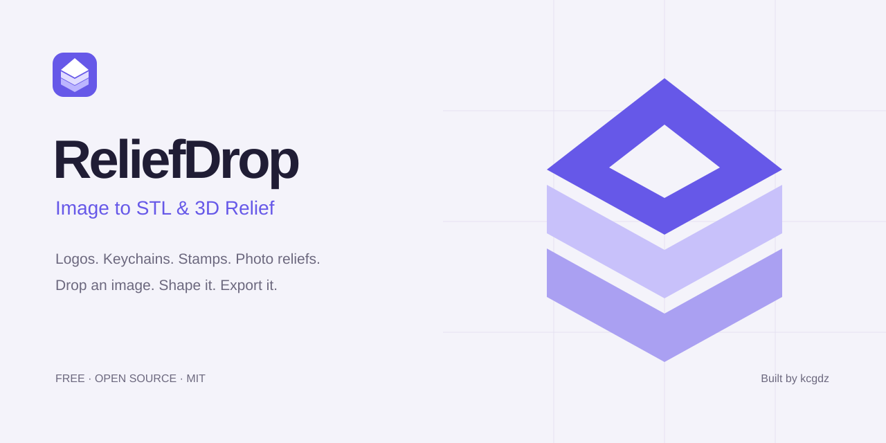

<div align="center">


# ReliefDrop — Image to STL & 3D Relief

**Turn an image into a layered 3D logo, keychain, stamp or photo relief — in your browser.**

PNG · JPG · WebP · SVG → STL · GLB · OBJ · PNG

Free and open source. No account. No build step. Image processing on your device.

Built by **[kcgdz](https://github.com/kcgdz)**.

[**Open ReliefDrop →**](https://kcgdz.github.io/ReliefDrop/)

[Quick start](#quick-start) · [Features](#features) · [Printing notes](#printing-notes) · [Contributing](#contributing)

</div>



## Features

- **Layered logos:** separate image colors into editable, solid raised layers.
- **Photo relief:** turn brightness into a closed heightfield with a flat back.
- **Keychain preset:** rounded backing plate, a dedicated attachment strip with a hole, and a 50 mm export size.
- **Stamp preset:** mirrored artwork, flat raised layers and a backing plate, with a 60 mm export size.
- **Editable geometry:** adjust depth, layer heights, edge bevels, smoothing and backing plates.
- **Interactive preview:** rotate, pan, zoom, inspect wireframes and try material finishes.
- **Export options:** binary STL, color GLB, OBJ and preview PNG.
- **English and Turkish:** English by default, with a manual switch and saved preference.
- **Light and dark themes:** light by default, with a saved preference; responsive layout, drag-and-drop and clipboard image input.

## Quick start

Serve this folder with any static web server. For example, with Python installed:

```sh
python -m http.server 8080
```

Open **http://localhost:8080** in a modern browser with WebGL enabled.

1. Choose an image, drop it on the page or paste it with **Ctrl+V**.
2. Choose **Logo** for flat artwork or **Relief** for photographs.
3. Optionally apply **Keychain** or **Stamp**. Presets replace geometry settings and reset per-layer height offsets.
4. Adjust the layers and dimensions, then download your model.

The included sample artwork lets you explore without uploading an image.

## Presets

| Preset | Starting setup | Best input |
| --- | --- | --- |
| Keychain | 50 mm longest side, backing plate, attachment hole | Transparent logos and bold icons |
| Stamp | 60 mm longest side, mirrored raised artwork, backing plate | High-contrast lettering and simple symbols |
| Custom | Logo mode, no plate, no mirror or attachment hole | Your own geometry settings |

Presets are starting points. Thickness and hole size scale with the final export dimensions; inspect the result in your slicer. The stamp preset creates the stamp face and backing, without a handle.

## Printing notes

- **This is 2.5D image extrusion and relief**, not AI reconstruction of a complete object from a photograph.
- STL and OBJ use millimetres; GLB uses metres. STL does not carry color, and this OBJ export does not include a material file.
- Separate logo colors remain separate meshes. Touching or overlapping meshes may need union or repair in your slicer; exports are not guaranteed to be a single manifold solid.
- For stamps, hide unwanted background layers and inspect the mirrored lettering before printing. Print material and ink affect the final impression.
- Photo relief maps brightness to height. It is not a calibrated lithophane generator.
- Very thin details, isolated artwork and extreme settings may require cleanup before printing.

## Privacy and dependencies

Local image files are processed in your browser; the application has no upload backend. It loads Three.js modules from jsDelivr and the Inter font from Google Fonts, so the default version needs an internet connection. The optional `?src=URL` parameter fetches an image from that URL and requires the remote server to allow cross-origin access.

## Project structure

```text
index.html   Interface, image analysis, Three.js scene and model exports
i18n.js      English/Turkish interface translation and language preference
studio.css   Responsive studio interface
assets/      ReliefDrop icon and project banner
README.md    Setup, capabilities and limitations
```

The included Pixern Studio logo is sample artwork; ReliefDrop is the application name.

Built with [Three.js](https://threejs.org/) and standard browser APIs. No framework or package installation required.

## Hosting on GitHub Pages

After pushing these files to GitHub, open **Settings → Pages**, choose **Deploy from a branch**, and select your branch and its root folder. Add the resulting demo address to the repository's About section.

## Contributing

Bug reports, example artwork and focused improvements are welcome. For geometry bugs, include the input image when you have permission to share it, browser version, mode, settings and a screenshot or exported model.

Useful next steps include explicit translation keys, more languages, multi-part 3MF export, geometry validation and accessible keyboard controls.

## License

Released under the [MIT License](LICENSE). Third-party dependencies retain their own licenses.
